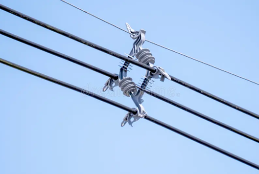

# CABLE — Cable Fault Detection with a From-Scratch CNN (MATLAB)

A MATLAB implementation of a convolutional neural network (CNN) built **from scratch** for cable/insulator image classification and fault detection. No Deep Learning Toolbox is required — convolution, pooling, activation, backpropagation and gradient descent are implemented directly in MATLAB.



## Highlights

- CNN layers implemented manually: convolution, activation, pooling and fully connected layers
- Forward propagation (`ffcnn`) and backpropagation (`bpcnn`)
- Gradient-descent training (`gradientdescentcnn`) with gradient checking (`gradient_checker`)
- Image preprocessing GUI: grayscale conversion, top-hat filtering and histogram equalisation
- PSNR / SNRR image-quality metrics
- Model save / load helpers (`savecnn`, `loadcnn`)
- Sample cable image included

## Tech Stack

`MATLAB` · `Image Processing Toolbox` · `CNN` · `Computer Vision`

## Project Structure

| File | Purpose |
| --- | --- |
| `input_data.m` / `.fig` | GUI to load an input image |
| `Preprocess_data.m` / `.fig` | Grayscale, top-hat filtering and contrast enhancement |
| `initcnn.m` | Initialise a CNN for a given input image size |
| `cnnAddConvLayer.m` | Add a convolution layer |
| `cnnAddPoolLayer.m` | Add a mean-pooling layer |
| `cnnAddFCLayer.m` | Add a fully connected layer |
| `cnnAddActLayer.m` | Add an activation layer |
| `ffcnn.m` | Forward propagation |
| `bpcnn.m` | Backpropagation |
| `gradientdescentcnn.m` | Gradient-descent weight update |
| `traincnn.m` | Train the network for a number of epochs |
| `testcnn.m` | Evaluate classification error |
| `gradient_checker.m` | Numerical gradient verification |
| `savecnn.m` / `loadcnn.m` | Persist / restore a trained model |
| `psnr.m` / `snrr.m` | Image-quality metrics |
| `anisodiff.m` | Anisotropic diffusion filtering |

## Getting Started

1. Clone the repository and open the folder in MATLAB.
2. Run `input_data` to load a cable image.
3. Run `Preprocess_data` to clean and enhance the image.
4. Build a CNN:

```matlab
cnn = initcnn(cnn, size_of_image);
cnn = cnnAddConvLayer(cnn, 6, [5 5], 'rect');
cnn = cnnAddPoolLayer(cnn, 2, 'mean');
cnn = cnnAddFCLayer(cnn, 10, 'sigm');
```

5. Train and evaluate:

```matlab
cnn = traincnn(cnn, x, y, no_of_epochs, batch_size);
err = testcnn(cnn, test_xx, test_yy);
```

6. Save the trained model:

```matlab
savecnn(cnn, 'cable_cnn.mat');
```

## Notes

- The training dataset is not included; prepare your own labelled cable/insulator image set.
- The preprocessing GUI uses `imtophat`, `histeq` and `imshow` from the Image Processing Toolbox.
- This project was built for learning and academic experimentation with CNN internals.

## Author

**Sathiya** — [GitHub](https://github.com/Sathiya-123321)
